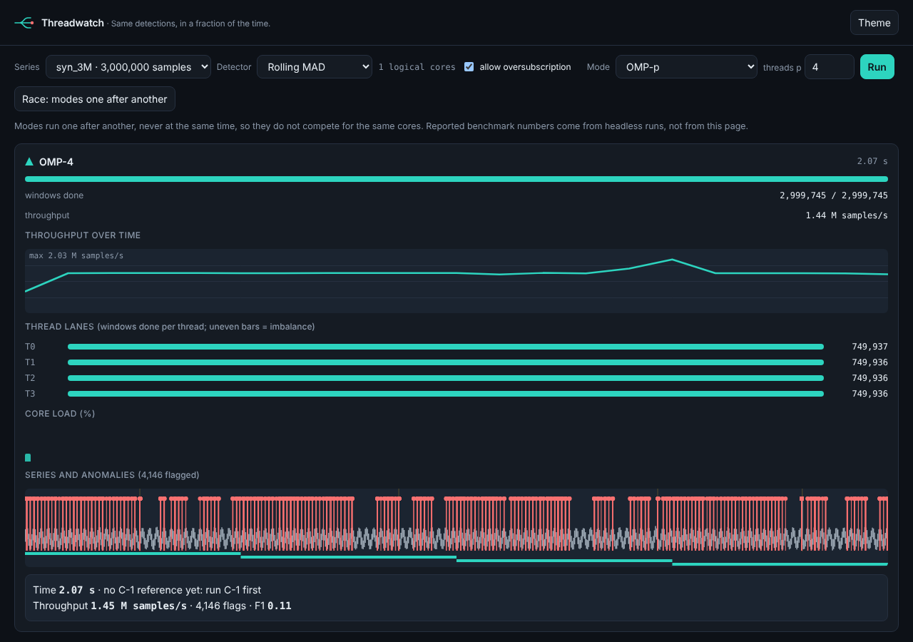
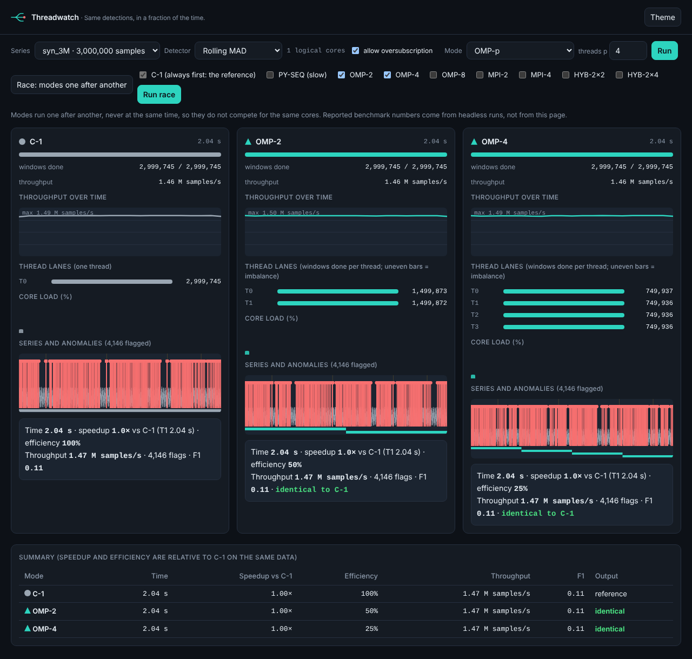
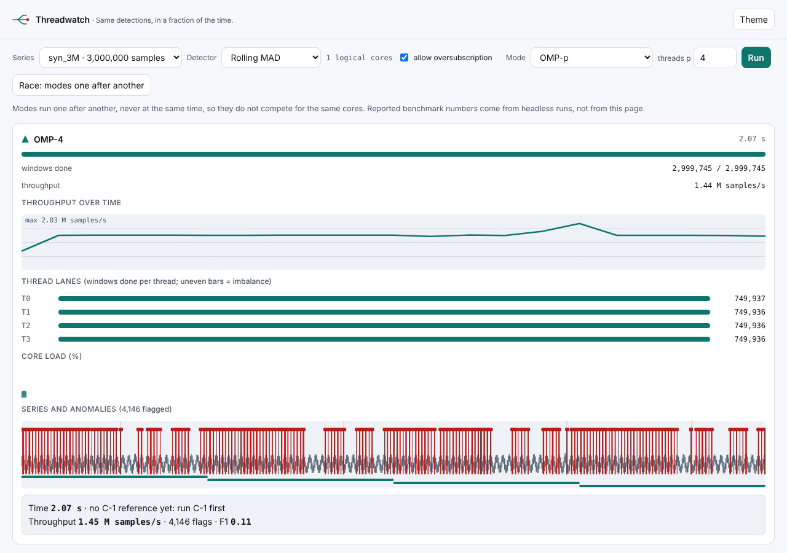
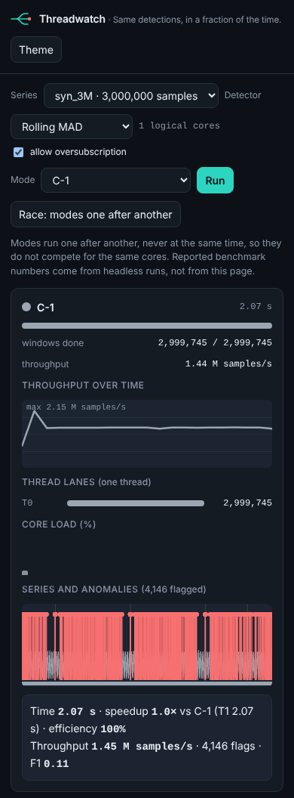

# Live dashboard (D-07)

A small web page that shows, while a run executes, how each approach works under the hood: progress, throughput,
how the windows are shared between threads, per-core CPU load and the anomalies as they are found.

> **Reported benchmark numbers always come from headless runs (D-08), never from this page.** Never run the
> dashboard during a benchmark campaign.

## Start

From the repo root, with the venv active (once: `pip install fastapi uvicorn httpx`; psutil is already a dependency):

```
python -m uvicorn threadwatch.service.app:app --port 8000
```

Open <http://127.0.0.1:8000>. The page is served by the same app, so there is no CORS to configure.
Environment: `THREADWATCH_ROOT` (default `.`) is the folder that holds `data/series`, `runs`, `experiments/out`.

## What you need on disk

| File | Needed for |
|---|---|
| `data/series/<name>.f32` | every run |
| `data/series/<name>.labels.u8` | F1 and the shaded labelled events (optional) |
| `data/series/<name>.kmeans.npz` (arrays `centroids`, `scale`) | the K-Means detector (optional) |
| `experiments/out/results.csv` | T1 (C-1 time) for a single run when no C-1 ran in this session |

## `out=` in `sdk.py`

`zscore`, `mad` and `kmeans_score` accept an optional caller buffer `out=` (float32, contiguous, one entry per window).
The run manager passes a memmap there, so the monitor sees scores while the kernel runs and flags appear live in C-1,
OMP-p and MPI/HYB file mode. Scatter mode fills the buffer after the gather, so its flags appear at the end.
For K-Means the feature stage has no counters: the bars stay at zero until the scoring stage starts.

## Modes

| Page | Request | Meaning |
|---|---|---|
| PY-SEQ | `mode: "PY-SEQ"` | D-03 NumPy detector in chunks; progress only; z-score and MAD |
| C-1 | `mode: "C-1"` | C kernel, 1 thread |
| OMP-p | `mode: "OMP", threads: p` | C kernel, p OpenMP threads |
| MPI-q | `mode: "MPI", ranks: q` | q ranks through `mpiexec`, 1 thread each |
| HYB-q×p | `mode: "HYB", ranks: q, threads: p` | q ranks, p threads each |

MPI and HYB take `inputMode`: `file` (every rank maps the file; flags are live) or `scatter` (rank 0 sends the slices;
flags appear after the gather). `ranks x threads` above the logical cores is refused unless `allowOversubscribe` is set.
**Only one run or race is active at a time** (a second request gets `409 busy`): two runs at once would compete for the cores.

## Panels

| Part | Data | Notes |
|---|---|---|
| Header: marker, mode, elapsed | `mode`, `t` | marker shapes: square PY-SEQ, circle C-1, triangle OMP, diamond MPI, hexagon HYB |
| Progress bar, windows done | `done`, `total` | |
| Throughput curve | `throughputSps` | fixed history of 300 points; the last event of a run shows the run average |
| Thread lanes | `threads[]` | one bar per thread (`R<r>·T<t>` for MPI); bar = share of that thread's own block, number = windows done. Uneven bars show imbalance. The numbers add up to the windows done. |
| Core bars | `cpu[]` | one bar per logical core (`psutil`) |
| Series strip | `strip`, `flags`, `blocks` | min/max per pixel column (never millions of points), labelled events shaded, per-thread progress bands underneath, flags as red circles with a stem |
| Final card | `result` | time, speedup vs C-1 **with its T1**, efficiency, throughput, F1, and `identical to C-1` in a race |

Light and dark themes (dark first), keyboard navigable with a visible focus ring, `prefers-reduced-motion` respected
(numbers keep updating, curves are drawn only when the run ends), panels stack under 768 px, and modes are told apart by
label and marker shape, not only by colour.

## Race

Pick modes and press **Run race**. C-1 always runs first (reference output and T1); then the others one after another,
never together. Each panel fills in turn; the summary table gives speedup and efficiency versus C-1 and whether each
output is identical to C-1. A mode that fails is shown with its error and the race continues.

## HTTP API

| Method | Path | Purpose |
|---|---|---|
| GET | `/api/health` | liveness, DLL version if the wrapper exposes `version()`, logical and physical cores, `mpiexec`, `busy` |
| GET | `/api/datasets` | `[{name, length, labelled, kmeansModel}]` |
| POST | `/api/runs` | `{dataset, detector, mode, threads, ranks, inputMode?, allowOversubscribe?}` -> `202 {runId, stream}` |
| GET | `/api/runs/{id}/stream` | SSE: `start`, many `progress`, then `done` (or `error`) |
| POST | `/api/race` | `{modes: ["OMP-4","MPI-4","HYB-2x4"], dataset, detector}` -> `202 {raceId, modes, stream}` |
| GET | `/api/race/{id}/stream` | SSE: `race_start`, then per mode `start`, `progress`, `mode_done` / `mode_error`, then `done {table}` |
| GET | `/api/results` | rows of `results.csv` as JSON (`?dataset=&detector=&mode=&limit=`) |

Errors are `{code, message}`. Unknown request fields are refused (`422`), not ignored.

`progress` event (a run's `mode` is its label):

```json
{"type":"progress","t":1.2,"mode":"OMP-4","done":1840000,"total":5000000,"throughputSps":1530000,
 "threads":[512000,498000,470000,360000],"cpu":[93,91,88,90,12,9,7,5],
 "flags":[{"i":1203441,"score":6.8}],"flagsTotal":14,"scoresLive":true}
```

`i` in a flag is the **sample index** the window score belongs to (`window * s + w - 1`), at most 50 flags per event,
the strongest ones if there are more; `flagsTotal` counts them all. Events carry an `id`; a browser that reconnects
resumes where it stopped (`Last-Event-ID`), and a page opened after the run replays it from the start. A comment line is
sent every 15 s and buffering is disabled, so proxies keep the stream open.

## How the monitor stays cheap

10 Hz, never faster; it reads only the part of the score array each thread has written since the last poll, found with the
`schedule(static)` block formula; at most 50 flags per event; no large arrays are parsed. `ctypes.CDLL` releases the GIL
during the kernel call, so the monitor thread keeps running (do not use `PyDLL`). Closing the browser tab does not stop or
slow a run: the run only writes to an event log that clients read. The run directory (`runs/<id>/`) is deleted when the run
ends, and at most 20 finished runs are kept in memory.

## Overhead (D-07.7)

```
python experiments/overhead.py --dataset syn_5M --detector mad --mode OMP --threads 4 --runs 10
```

Alternates headless and dashboard runs (after a warm-up) and reports the median overhead against the 2 % limit in
`experiments/out/overhead.json`. **No overhead figure is committed here**: paste the line the script prints once you have
run it on the target machine, idle, with the real DLL.

| Mode | Dataset | Detector | Headless median | Dashboard median | Overhead | IQR |
|---|---|---|---|---|---|---|
| _to be filled_ | | | | | | |

If it fails, the first suspect is the memory-mapped score buffer (page-fault and dirty-page cost of writing the scores
through a file); for in-process runs a plain NumPy array would do, the memmap is only needed for MPI ranks.

## Tests

```
pytest tests/python/test_service.py
```

API and SSE with FastAPI's `TestClient`: stream order, lanes adding up to the total, flags live versus at the end,
one run at a time, reconnect and replay, race order and non-overlap, T1 handling, error events, run-directory cleanup,
and real `mpiexec` runs (MPI, hybrid, scatter) when an MPI runtime is installed (`TW_MPIEXEC` overrides the command).

## Screenshots

Captured with a **simulated kernel** (a stand-in that only advances the counters), on a 3 M-sample series, in a sandbox
with one core. They show the layout, not performance.





