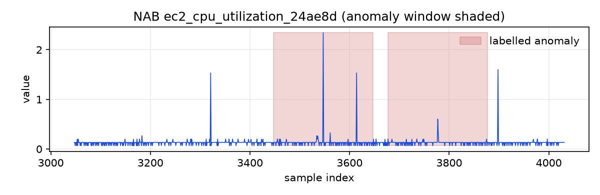
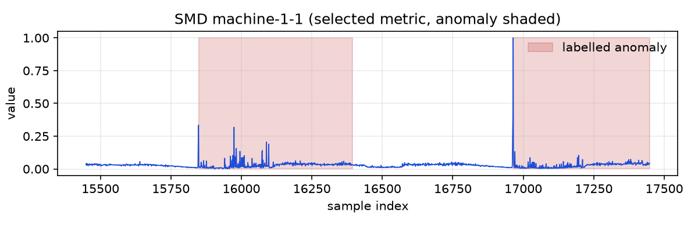
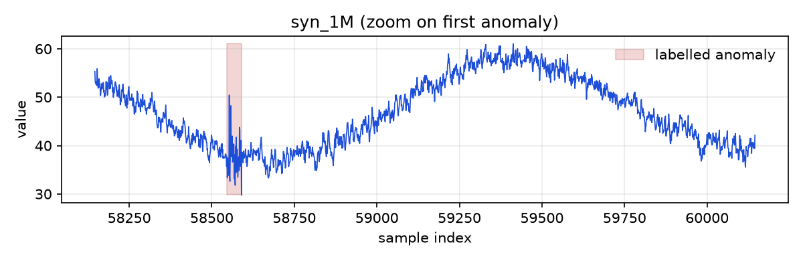

# Data sheet

Generated by `python -m threadwatch.data sheet` from the files in `data/series/`. Sizes, rates and sampling intervals are measured; licences are quoted from the downloaded licence files. Format: `.f32` (little-endian float32) + `.labels.u8` + `.json`.

## NAB (AWS CloudWatch)

| Item | Value |
|---|---|
| Source | NAB |
| Series | 17 |
| Total samples | 67,740 |
| Samples per series | min 1,243 / max 4,730 |
| Sampling interval | 5 min |
| Anomaly rate | mean 9.33% (min 0.00%, max 10.14%) |
| Missing values forward-filled | 0 |
| Disk size (f32 + labels) | 0.3 MB |
| Licence | MIT-style permission notice (Copyright 2014-2024 Numenta Inc.) |

Labels: NAB provides anomaly windows (start, end) per file; a sample is labelled 1 if its timestamp lies inside a window, bounds included. Selection: all files of `realAWSCloudwatch/`. Series without any labelled window (F1 undefined, kept for timing): nab_ec2_cpu_utilization_c6585a.

These series are short (about 1.2k to 4.7k samples): they measure detection quality, not scaling.

## SMD (Server Machine Dataset)

| Item | Value |
|---|---|
| Source | SMD |
| Series | 28 |
| Total samples | 708,420 |
| Samples per series | min 23,687 / max 28,743 |
| Sampling interval | 1 min |
| Anomaly rate | mean 4.21% (min 0.42%, max 15.65%) |
| Missing values forward-filled | 0 |
| Disk size (f32 + labels) | 3.5 MB |
| Licence | MIT licence (MIT License) |

Test split only (labelled). SMD has 38 unnamed metrics per machine; one metric per machine is used: the dimension appearing in the most anomaly segments of that machine's `interpretation_label` file (ties: lowest index). 0-based column used per machine:

machine-1-1: 8, machine-1-2: 6, machine-1-3: 11, machine-1-4: 11, machine-1-5: 23, machine-1-6: 12, machine-1-7: 8, machine-1-8: 10, machine-2-1: 8, machine-2-2: 10, machine-2-3: 0, machine-2-4: 13, machine-2-5: 12, machine-2-6: 0, machine-2-7: 12, machine-2-8: 0, machine-2-9: 12, machine-3-1: 0, machine-3-10: 13, machine-3-11: 0, machine-3-2: 12, machine-3-3: 11, machine-3-4: 1, machine-3-5: 29, machine-3-6: 0, machine-3-7: 0, machine-3-8: 0, machine-3-9: 0

## Synthetic generator

| Item | Value |
|---|---|
| Source | synthetic |
| Series | 5 |
| Total samples | 38,000,000 |
| Samples per series | min 1,000,000 / max 20,000,000 |
| Sampling interval | 1 min (period_day=1440) |
| Anomaly rate | mean 0.10% (min 0.10%, max 0.11%) |
| Missing values forward-filled | 0 |
| Disk size (f32 + labels) | 190.0 MB |
| Licence | own code (this repository) |

Trend + daily and weekly cycles + AR(1) noise (phi 0.7) + labelled spikes, level shifts and variance bursts. Requested rate 0.1%; events are drawn until the labelled samples reach the target and never overlap. Same seed gives identical bytes. For timing only: F1 on synthetic data measures the generator, not real detection quality.

| Name | n | seed | events | anomaly rate |
|---|---|---|---|---|
| syn_10M | 10,000,000 | 7 | 128 | 0.100% |
| syn_1M | 1,000,000 | 7 | 18 | 0.105% |
| syn_20M | 20,000,000 | 7 | 247 | 0.100% |
| syn_2M | 2,000,000 | 7 | 27 | 0.105% |
| syn_5M | 5,000,000 | 7 | 69 | 0.102% |

