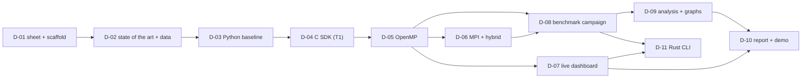

# Threadwatch - Deliverables

Each deliverable has its own folder and README with: what the part is responsible for, the tech stack used and the role of each tool, inputs and outputs, tasks, pseudo code, files to create, tests and acceptance, and pitfalls.

**Format:** `D-nn - Title`. Every deliverable gets its own branch `d-nn-slug`, a merge to `main` when its acceptance checks pass, one line in `CHANGELOG.md`, and is then **sent to the teacher** as the item named in the table. Big deliverables are split into tasks `D-nn.k`.

| ID | Title | Teacher's expected item | What is sent | README |
|---|---|---|---|---|
| D-01 | Project sheet and repository scaffold | Fiche de projet | 1 to 2 page project sheet (PDF) | [D-01](D-01-repo-scaffold/README.md) |
| D-02 | State of the art and datasets | État de l'art et description des données | short literature review + data sheet | [D-02](D-02-state-of-art-and-data/README.md) |
| D-03 | Python sequential baseline | Première version fonctionnelle | code + F1 table + first timings | [D-03](D-03-python-sequential-baseline/README.md) |
| D-04 | C SDK, sequential (T1) | Résultats séquentiels | DLL + loader + T_py, T1 table | [D-04](D-04-c-sdk-sequential/README.md) |
| D-05 | OpenMP parallel SDK | Programme parallèle | DLL with OpenMP + determinism proof | [D-05](D-05-openmp-parallel-sdk/README.md) |
| D-06 | MPI and hybrid driver | Programme parallèle (completes it) | MPI + hybrid driver + equivalence proof | [D-06](D-06-mpi-and-hybrid/README.md) |
| D-07 | Live dashboard | extra, shown in the demonstration | dashboard + 1-minute screen recording | [D-07](D-07-live-dashboard/README.md) |
| D-08 | Benchmark campaign | Tableaux de résultats | `results.csv` + summary tables | [D-08](D-08-benchmark-campaign/README.md) |
| D-09 | Analysis, graphs and interpretation | Graphiques et interprétation | figures + reading of H1 to H4 | [D-09](D-09-analysis-and-graphs/README.md) |
| D-10 | Final report and demonstration | Rapport final et démonstration | report (PDF) + demo script + release | [D-10](D-10-report-and-demo/README.md) |
| D-11 | Rust CLI (`tw`) | extra, optional | CLI binary + `docs/cli.md` + short screen recording | [D-11](D-11-rust-cli/README.md) |

## Dependency order

## Sending rule

A deliverable is sent when its acceptance checks pass, in the order of the table. The next one starts from the merged result of the previous one, so nothing sent changes later without a changelog line.

## Cut lines if the scope must shrink

1. Drop the 50M size and the second stride experiment.
2. Drop the static versus dynamic schedule comparison and the optional sliding-sum kernel.
3. Run Isolation Forest and K-Means only at small sizes, and keep them for the quality comparison.
4. Keep only the MPI file mode and drop scatter.
5. Drop hybrid, keeping OpenMP and MPI.
6. Reduce the race view in the dashboard to a single-run view.
7. D-11 (the CLI) is optional: `make` targets and the Python commands do the same work without it.

## Definition of done (all deliverables)

Tests pass, acceptance criteria in the README are met, docs updated, changelog line added, branch merged, deliverable sent.
