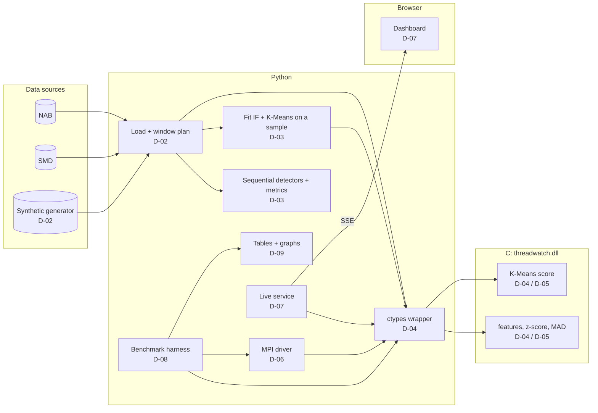

# Threadwatch — Implementation Docs

## 1. Plan at a glance

- **Shape of the work:** eleven deliverables (`D-01` to `D-11`). Eight of them are the items the teacher expects, in the same order; `D-06` completes the parallel program, `D-07` is the live dashboard that supports the demonstration, and `D-11` is a Rust command-line tool that runs everything from the terminal.
- **Method:** a sequential reference first, then parallel versions, then measurements, in the eight steps of the course brief: problem, bibliography, data, sequential version, parallelisation, experiments, evaluation, report and demo.
- **Rule:** a deliverable is sent only when it is testable (acceptance in its README). Commits are prefixed `D-nn:`.
- **Vertical slice first:** D-01 to D-04 give a working end-to-end path (data → detector → metric → timing) in Python and in C before any parallel code is written.

## 2. Role of each part of the stack

| Tech | Role in Threadwatch | What you learn |
|---|---|---|
| **C11 + GCC** | The SDK: window features and detector kernels | cache-friendly loops, a clean ABI, no hidden state |
| **OpenMP** | Thread parallelism inside the kernels | work sharing, scheduling, false sharing, determinism |
| **DLL + `ctypes`** | The bridge: Python calls the SDK with NumPy arrays and no copies | ABI design, struct layout, GIL release, DLL search paths |
| **Python** | Data, ML fitting, orchestration, metrics, benchmark harness, live service | measurement discipline, experiment design |
| **scikit-learn** | Isolation Forest and K-Means, F1 | model fitting on samples, library-level parallelism |
| **MPI (`mpi4py`, MS-MPI)** | Processes, scatter/gather, hybrid runs | domain decomposition, halo (overlap) regions, communication cost |
| **FastAPI + SSE** | Start runs and stream live events | simple streaming APIs |
| **HTML + CSS + vanilla JS** | The live dashboard | canvas drawing, SSE, responsive layout, accessibility |
| **Rust (`tw` CLI)** | One fast command to build, test, run, race and benchmark, with choice menus for parameters and a terminal live view | process orchestration, memory-mapped reads, terminal UIs, low-overhead design |

### Why `ctypes` and a DLL, not a compiled Python extension

The DLL is a reusable SDK: any language can call it, and the C code has no Python dependency. `ctypes` needs only typed signatures and works with NumPy arrays directly. The cost is manual signatures and care with DLL search paths on Windows; the equivalence tests catch signature mistakes.

### Why plain JavaScript and no framework

The dashboard has four panels and one data stream. A framework adds a build step and dependencies without removing any real complexity. Canvas plus a small SSE client is enough, and the page can be opened straight from the Python service.

## 3. The pipeline (end to end)



## 4. Maths and definitions (for the report)

1. **Windows.** For a series `x` of length `n`, window length `w`, stride `s`: `nw = floor((n - w) / s) + 1`; window `i` is `x[i·s .. i·s + w - 1]`. The score of window `i` is attached to sample `t_i = i·s + w - 1` (its last point).
2. **Rolling z-score.** `mu = (1/w) Σ x_k`, `sigma = sqrt( (1/(w-1)) Σ (x_k - mu)^2 )`, `score = |x_last - mu| / sigma` (0 if `sigma < 1e-12`). Sums are accumulated in `double`; the result is stored as `float`.
3. **Rolling median / MAD.** `m = median(window)`, `MAD = median(|x_k - m|)`, `score = |x_last - m| / (1.4826 · MAD + 1e-12)`. The median is found by quickselect on a per-thread copy of the window (for even `w`, the mean of the two middle values).
4. **Window features** (input of the ML detectors): `[mean, std, min, max]`.
5. **K-Means distance.** Fit K-Means (k = 8) on a sample of feature vectors; per-feature scale `scale_j = 1 / std_j` from the sample. `score = min_c sqrt( Σ_j ((f_j - c_j) · scale_j)^2 )`.
6. **Isolation Forest.** `s(x, psi) = 2^( -E[h(x)] / c(psi) )` with `c(psi) = 2 H(psi - 1) - 2 (psi - 1) / psi` (`H` the harmonic number). Defaults: 100 trees, `max_samples = 256`. scikit-learn's `score_samples` returns the negative of `s`; use `-score_samples(F)` as the anomaly score.
7. **Threshold.** For every detector, the `(1 - rho)` quantile of the scores on the fit sample, with `rho` the expected anomaly rate (default 0.1%). It is computed once and reused by every mode, so parallelism cannot change it.
8. **Quality.** Point-wise precision, recall and F1 on flags at `t_i` against the labels. *Event recall:* an event is a maximal run of label 1; it is found if a flag falls in `[start - tau, end + tau]` with `tau = w / 2`. Report both; state which one the headline figure uses.
9. **Performance.**
   - Speedup `S_p = T1 / T_p`; efficiency `E_p = S_p / p`; throughput `n / T_p` (samples per second).
   - Amdahl: `S_p <= 1 / (f + (1 - f) / p)` with `f` the serial fraction.
   - Karp-Flatt: `e = (1 / S_p - 1 / p) / (1 - 1 / p)`. A constant `e` means a fixed serial part; a growing `e` means growing overhead.
   - Language gain `G_lang = T_py / T1`, never mixed into `S_p`.
10. **Overlap rule (MPI).** Rank `r` handles windows `[a_r, b_r)` and reads samples `a_r·s .. (b_r - 1)·s + w - 1`. Each window then lies entirely in one rank's slice, so its score is computed from the same `w` values as in the sequential run. Extra samples read per boundary: `w - s`.
11. **Why results are identical across thread counts.** One window is computed by one thread, always in the same order, with no cross-thread reduction. No `-ffast-math`, so the compiler does not reorder floating-point operations. Therefore the output does not depend on the thread count. (The optional sliding-sum kernel in D-05 breaks this on purpose and is reported separately.)

## 5. Order of work

| Order | Deliverable | Teacher's expected item |
|---|---|---|
| 1 | D-01 Project sheet and repository scaffold | Fiche de projet |
| 2 | D-02 State of the art and datasets | État de l'art et description des données |
| 3 | D-03 Python sequential baseline | Première version fonctionnelle |
| 4 | D-04 C SDK, sequential (T1) | Résultats séquentiels |
| 5 | D-05 OpenMP parallel SDK | Programme parallèle |
| 6 | D-06 MPI and hybrid driver | Programme parallèle (completes it) |
| 7 | D-07 Live dashboard | extra, shown in the demonstration |
| 8 | D-08 Benchmark campaign | Tableaux de résultats |
| 9 | D-09 Analysis, graphs and interpretation | Graphiques et interprétation |
| 10 | D-10 Final report and demonstration | Rapport final et démonstration |
| 11 | D-11 Rust CLI (`tw`) | extra, optional |

D-07 only needs D-05, so it can be built while D-06 and D-08 are in progress. D-11 comes last: it needs the progress-file contract of D-07 and the runner of D-08, and it is optional for the teacher's items. Dependencies are in `deliverables/README.md`.

## 6. Repo layout

```
threadwatch/
├─ sdk/
│  ├─ include/threadwatch.h
│  ├─ src/                 # common.c, features.c, zscore.c, mad.c, kmeans.c
│  ├─ tests/               # C smoke tests
│  └─ Makefile             # builds build/threadwatch.dll
├─ python/threadwatch/     # lib.py (ctypes), data/, detectors/, metrics.py, mpi/, bench/, service/
├─ tests/python/
├─ apps/dashboard/         # index.html, style.css, app.js
├─ crates/tw-cli/          # Rust CLI (binary `tw`)
├─ experiments/            # run_matrix.py, out/ (results.csv, machine.json, figures/)
├─ docs/                   # these docs, deliverables/, design/, math.md, data.md, perf.md
├─ report/                 # report sources
├─ data/                   # gitignored: raw/ and series/
├─ CHANGELOG.md  Makefile  pyproject.toml
```

## 7. Suggested libraries (verify current versions when you start)

- **C:** GCC from MSYS2 UCRT64 (`mingw-w64-ucrt-x86_64-gcc`), `make`, OpenMP (`libgomp`, included with GCC).
- **Python:** `numpy`, `pandas`, `scikit-learn`, `matplotlib`, `mpi4py`, `fastapi`, `uvicorn`, `psutil`, `pytest`, `ruff`. Optional: `pyarrow`, `threadpoolctl` (to pin library threads in PY-SEQ).
- **MPI runtime:** Microsoft MS-MPI (runtime and SDK) on Windows.
- **Rust (D-11):** `clap`, `cliclack` (choice menus), `indicatif`, `ratatui` with `crossterm`, `num_cpus`, `memmap2`, `serde`, `serde_json`, `csv`, `anyhow`, `ctrlc`, `which`, `sysinfo`; optional `libloading`; tests with `assert_cmd` and `tempfile`.
- **Browser:** no library. Inter and JetBrains Mono from Google Fonts, with system fallbacks.

## 8. Working agreement

1. **Reference first:** no parallel code before the sequential C version passes the equivalence tests.
2. **One writer per output slot:** a design rule for every kernel; it is what keeps results deterministic.
3. **Never edit results by hand:** every number in the report comes from `experiments/out/results.csv`; every graph is produced by a script.
4. **Fair timing:** benchmarks run headless, on an idle machine, with the same input file for every mode.
5. **Label honestly:** report the machine, the thread counts, and every case where parallel is slower.
6. **Definition of done:** tests pass, acceptance criteria met, docs updated, `CHANGELOG.md` line added, branch merged, deliverable sent.

## 9. Changelog format (`CHANGELOG.md`)

```
## [0.1.0] - YYYY-MM-DD
### Added
- D-04: C SDK kernels (threads=1), equivalence < 1e-5 vs NumPy
### Changed
### Fixed
### Known limitations
```

One entry per deliverable; a final "Project summary" section lists hypotheses H1 to H4 and their outcomes.

## 10. Risks and mitigations

| Risk | Impact | Mitigation |
|---|---|---|
| DLL fails to load on Windows (missing `libgomp-1.dll`, 32/64-bit mismatch) | blocks D-04 | the "hello DLL" check is part of D-01; use `os.add_dll_directory` and a 64-bit Python and compiler |
| MS-MPI or `mpi4py` install problems | blocks D-06 | test `mpiexec -n 2` in D-01; fallback: run MPI cells under WSL with Open MPI and a `.so` build |
| Parallel results differ from sequential | breaks H2 | one writer per slot, no `-ffast-math`, determinism test in D-05 |
| Timings noisy on a laptop | weak conclusions | idle machine, power plan on high performance, warm-up, at least 5 runs, report median and spread |
| Thermal throttling or turbo drift | speedup looks wrong | keep runs short and interleaved; record the CPU model and note throttling |
| Isolation Forest scoring too slow at large sizes | long benchmark | cap its size (default 2M) and report it as a library-parallelism case |
| Memory limits at 20M+ samples | crashes | use `float32`, memory-mapped input, stride above 1 for the largest size |
| Dashboard disturbs timings | invalid numbers | headless runs for all reported figures; measure the dashboard overhead in D-07 |
| CLI animation disturbs timings | invalid numbers | `tw bench` never animates during timed cells; measure the live-view overhead in D-11 |
| Rust toolchain friction on Windows (MSVC build tools) | blocks D-11 | use `stable-x86_64-pc-windows-gnu`; the CLI only starts external processes, so the toolchains are independent |
| Real datasets too small to show scaling | scaling claims weak | scaling uses synthetic series; real data is used for quality only |

## 11. Environment setup

The exact commands for MSYS2, GCC, Python, MS-MPI and the smoke tests are in `deliverables/D-01-repo-scaffold/README.md`. When every smoke test there passes, you are ready to implement D-02.
