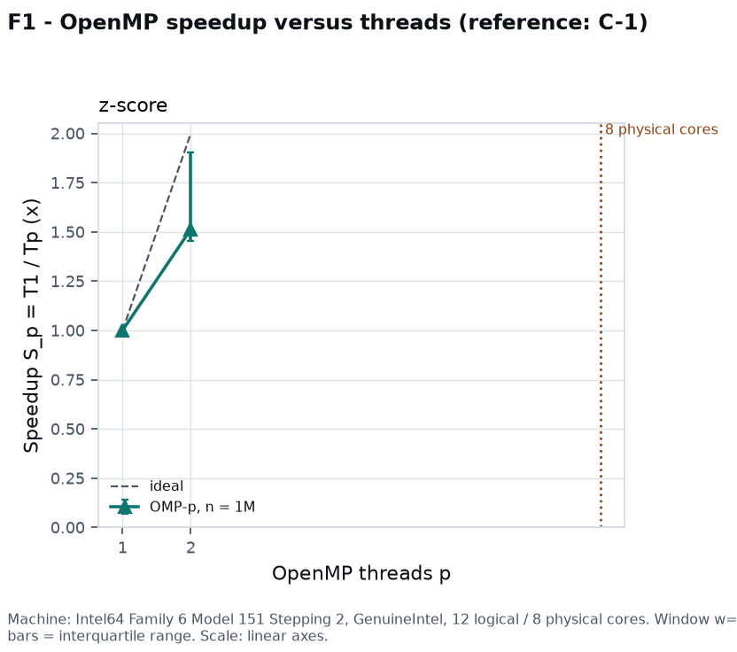
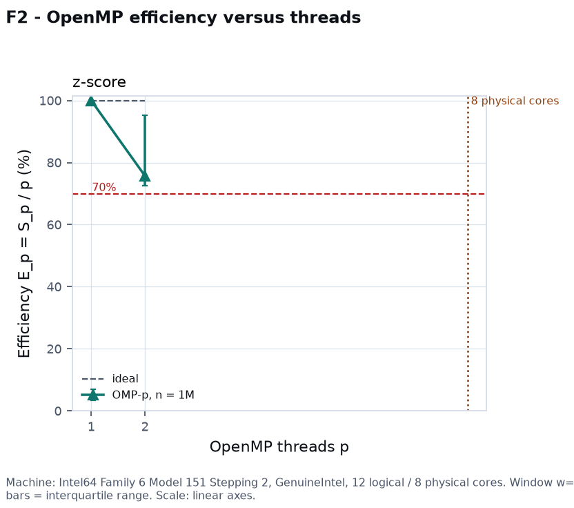
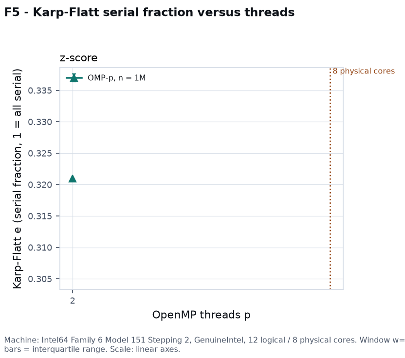
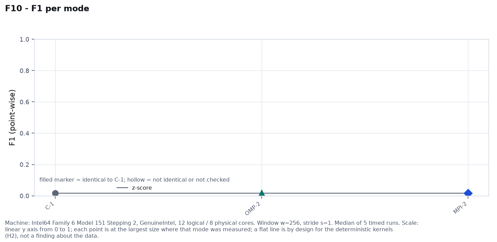
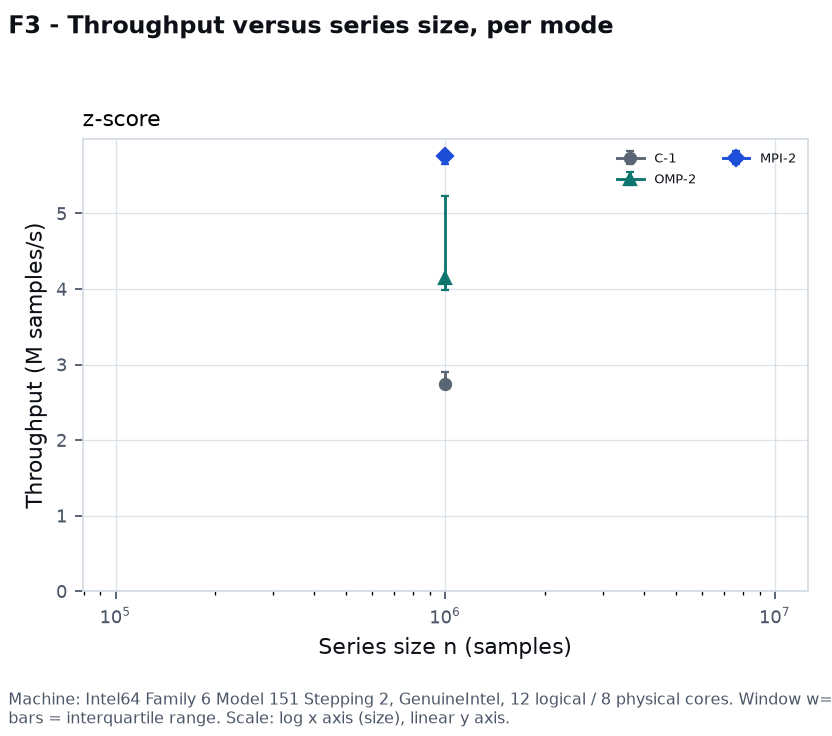
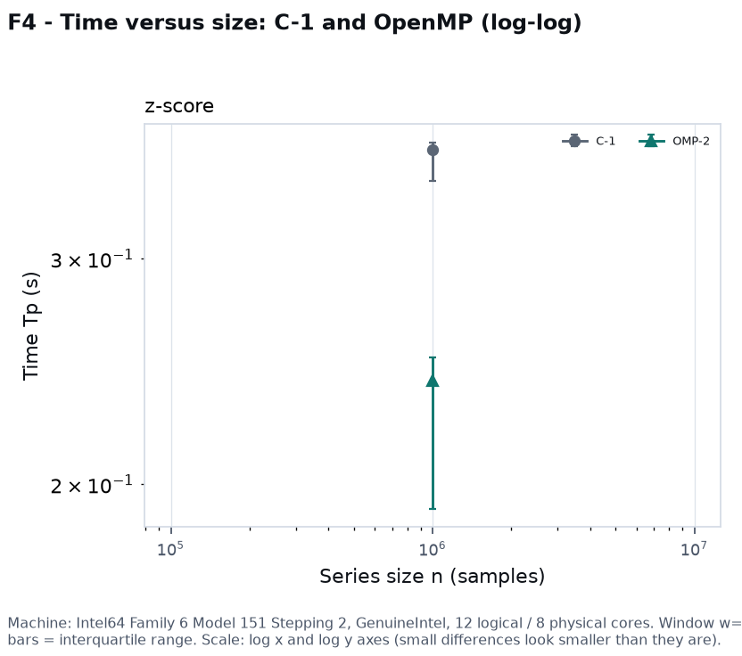
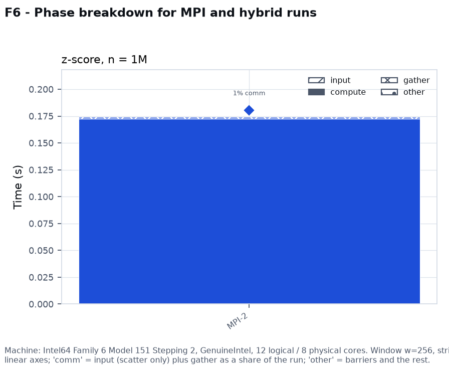
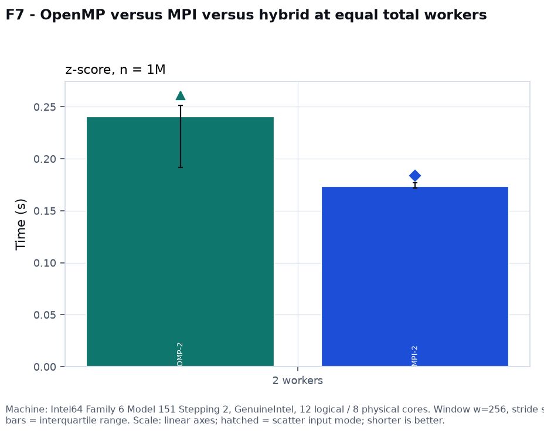

# Results and interpretation (D-09)
Generated by `python experiments/run_analysis.py` from `experiments/out/results.csv`. Do not edit by hand.

**Machine:** Intel64 Family 6 Model 151 Stepping 2, GenuineIntel, 12 logical / 8 physical cores, 11.7 GB RAM, Windows-11-10.0.26200-SP0. **Protocol:** w=256, s=1; 5 timed runs per cell (median, IQR as spread); T1 is the C-1 median of the same size and detector; speedup and efficiency are never computed against Python.

## Verdicts

| | Hypothesis | Result |
|---|---|---|
| H1 | OpenMP efficiency: z-score and MAD keep parallel efficiency above 70% up to the physical core count. | **supported** |
| H2 | Equivalence: parallel outputs are identical to the 1-thread outputs, so F1 does not change. | **supported** |
| H3 | Size: below a threshold size parallel overhead makes a run slower than one thread; the crossover is measured. | **inconclusive** |
| H4 | MPI: on a single machine MPI does not beat OpenMP; hybrid helps only when ranks x threads is tuned. | **rejected** |

## H1 - OpenMP efficiency

**Result:** supported

**Evidence:** F1, F2, F5 (F9 for the schedule comparison).

- z-score at 1M: p=2: S=1.51, E=76%
- z-score Karp-Flatt trend up to 8 threads: not enough points
- NOTE: the physical core count (8) was not measured; the verdict covers thread counts up to 2. Add 8 to the OMP thread list to cover it.

**Reading:** z-score: efficiency stays at or above 70% at every measured thread count up to 2.

**Limit:** One machine (Intel64 Family 6 Model 151 Stepping 2, GenuineIntel, 12 logical / 8 physical cores, 11.7 GB RAM, Windows-11-10.0.26200-SP0). Kernels: z-score and MAD, sizes 1M. Thread counts measured: [2]; the physical core count (8) was not measured itself (largest tested at or below it: 2). Runs per cell: 5. The optional sliding-sum variant is not part of these results.

_F09: no data: experiments/out/schedule_mad.csv is missing. It is the output of the D-05.6 experiment, with columns dataset, n, threads, schedule (static or dynamic), repeat, total_s. It is not produced by the D-08 matrix._

## H2 - Equivalence

**Result:** supported

**Evidence:** F10 and the quality table.

- 2 of 2 OMP/MPI/HYB cells of z-score, MAD and K-Means are identical to C-1 in every timed run
- largest F1 range across all modes of one (kernel, size): 0.0000

**Reading:** Identity is a design property: one writer per output slot, no reduction across threads, no fast-math, so the result does not depend on threads or ranks. It is a check that the implementation keeps that property, not a finding about the data.

**Limit:** Exact comparison (array equality) of every timed run against the C-1 output of the same block. One machine (Intel64 Family 6 Model 151 Stepping 2, GenuineIntel, 12 logical / 8 physical cores, 11.7 GB RAM, Windows-11-10.0.26200-SP0); sizes and modes as measured.

## H3 - Size

**Result:** inconclusive

**Evidence:** F3, F4 and the not-faster table.

- smallest measured size: 1M
- 2 (kernel, mode) series: 0 with a located crossover, 0 slower at the measured sizes, 2 faster at every measured size

**Reading:** No parallel mode was clearly slower than C-1 at any measured size, and the smallest size is 1M: the region where overhead dominates, if it exists, lies below the measured range. Add smaller sizes to the matrix (for example 100k, 250k, 500k) to locate it.

**Limit:** Sizes measured: 1M. 'Slower' and 'faster' require non-overlapping IQRs (5 runs per cell); overlapping IQRs are reported as no measurable difference. One machine (Intel64 Family 6 Model 151 Stepping 2, GenuineIntel, 12 logical / 8 physical cores, 11.7 GB RAM, Windows-11-10.0.26200-SP0).

## H4 - MPI

**Result:** rejected

**Evidence:** F6, F7 and the equal-workers table.

- MPI (file input) versus OpenMP at equal workers, sizes 1M: MPI clearly faster in 1, clearly slower in 0, no measurable difference in 0 of 1 comparisons
- median share of the MPI run spent in input and gather: 1%
- fastest parallel configuration, z-score at 1M: MPI-2 (0.174 s, S=2.10)

**Reading:** On one machine every rank shares the same memory and cores, and MPI adds input and gather work that OpenMP does not have; here MPI was sometimes clearly faster than OpenMP at equal workers. 

**Limit:** Equal-workers comparisons exist only for the shapes in the matrix (MPI-2, MPI-4; HYB-2x2, HYB-2x4). One machine (Intel64 Family 6 Model 151 Stepping 2, GenuineIntel, 12 logical / 8 physical cores, 11.7 GB RAM, Windows-11-10.0.26200-SP0). The ranks run on the same host: this says nothing about a cluster, where memory is not shared and the network replaces shared memory.

## Where parallel is not faster

No parallel cell was slower than or indistinguishable from C-1 among the 2 measured; the smallest size is 1M. Any region where overhead wins lies below the measured sizes.

## Quality versus mode (F1 and identity with C-1)

F1 is identical across modes for the deterministic kernels by design (H2); it is not a finding about the data.

F1 at the largest size of each kernel ("differs" = not identical to C-1):

| detector | n | C-1 | OMP-2 | MPI-2 |
|---|---|---|---|---|
| zscore | 1000000 | 0.017 | 0.017 | 0.017 |

All sizes, precision, recall and event recall: `experiments/out/tables/quality_vs_mode.csv`.

## Language gain and parallel gain

`G_lang = T_py / T1` is the effect of the language; `S_p = T1 / Tp` is the effect of parallelism. They are separate.

_no data_

## Figures

- F01 (H1): Speedup versus threads, per kernel, with the ideal line - `experiments/out/figures/F01.png`
- F02 (H1): Efficiency versus threads - `experiments/out/figures/F02.png`
- F03 (H3): Throughput versus series size, per mode - `experiments/out/figures/F03.png`
- F04 (H3): Time versus size for C-1 and OMP-p (log axes) - `experiments/out/figures/F04.png`
- F05 (H1): Karp-Flatt serial fraction versus threads - `experiments/out/figures/F05.png`
- F06 (H4): Phase breakdown for MPI and HYB - `experiments/out/figures/F06.png`
- F07 (H4): OMP-p versus MPI-q versus HYB at equal total workers - `experiments/out/figures/F07.png`
- F08 (claim hygiene): Language gain and parallel gain, side by side - no data: no PY-SEQ cells, so G_lang cannot be computed
- F09 (H1): schedule(static) versus schedule(dynamic) on MAD - no data: experiments/out/schedule_mad.csv is missing. It is the output of the D-05.6 experiment, with columns dataset, n, threads, schedule (static or dynamic), repeat, total_s. It is not produced by the D-08 matrix.
- F10 (H2): F1 per mode - `experiments/out/figures/F10.png`

## How the verdicts are decided

Every verdict is computed from the data by these rules (`experiments/analysis/interpret.py`); a result is *inconclusive* when the data
cannot settle the question.

- **Medians and spread.** Medians of the timed runs; the interquartile range (IQR) is the spread. Two cells are different only if their IQRs do not overlap.
- **H1.** z-score and MAD, OpenMP, sizes of at least 5M (else the largest size), thread counts up to the physical core count. Supported if the median efficiency
  is at least 70% in every such cell; rejected if in some cell even the fast end of the IQR is below it; inconclusive otherwise.
- **H2.** Deterministic kernels (z-score, MAD, K-Means), every OMP, MPI and HYB cell: supported if all are identical to C-1, rejected if any is not, inconclusive if identity was not checked everywhere.
- **H3.** A parallel mode is *slower* than C-1 only if its IQR lies entirely above C-1's, *faster* if entirely below. Supported if a slower-to-faster crossover is located;
  rejected only if the smallest size is at most 100k and every parallel mode was clearly faster; inconclusive otherwise.
- **H4.** At equal workers and large sizes, MPI with file input against OpenMP: supported if MPI is never clearly faster, rejected if it is clearly faster in more than half of the comparisons, inconclusive otherwise. Hybrid and scatter are reported alongside.
- **Causes** in the readings are plausible explanations drawn from the numbers (physical cores, Karp-Flatt trend, communication share); they are marked as not tested separately.
- **Efficiency beyond the physical cores** is lower by construction (threads share cores); the physical core count is marked on the plots.
