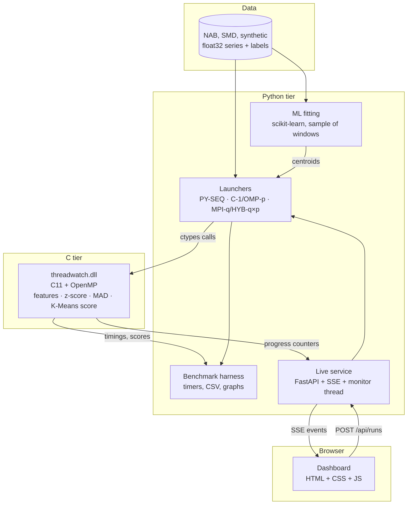
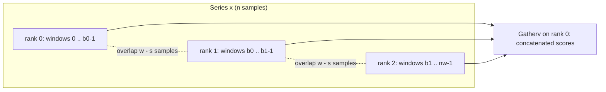
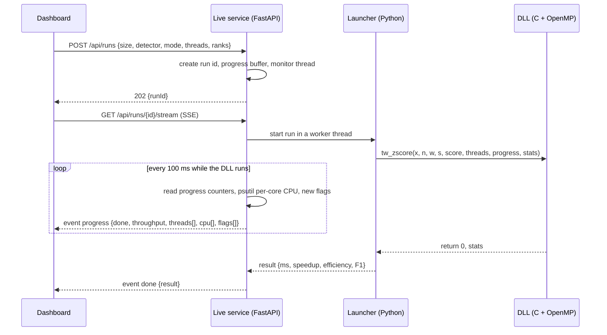

# Threadwatch — System Architecture

## 1. Principle

**The C library owns all computation. Python orchestrates. JavaScript only displays.** Every execution mode (Python baseline, C-1, OpenMP, MPI, hybrid) calls the same kernels, so a speedup can only come from the way they are run. The dashboard never computes detections; it renders what the service streams.

## 2. Component map



## 3. Responsibilities

| Layer | Tech | Owns | Must NOT |
|---|---|---|---|
| Data | Python, NumPy, binary `float32` files | dataset loading, synthetic generation, labels | run detection |
| Threadwatch SDK | C11, OpenMP, GCC (MSYS2 UCRT64) | window features, z-score, MAD, K-Means scoring, per-thread progress counters | file I/O, plotting, Python objects, global state |
| Python wrapper | Python, `ctypes`, NumPy | load the DLL, typed signatures, pass arrays without copying, map error codes to exceptions | re-implement hot loops that exist in C |
| ML layer | Python, scikit-learn | fit Isolation Forest and K-Means on a sample, export centroids, compute F1 | score the whole series in a Python loop |
| MPI driver | Python, `mpi4py`, MS-MPI | split the series with overlap, start ranks, gather results | change detector logic |
| Benchmark harness | Python, pandas, matplotlib | run the configuration matrix, timers, speedup, efficiency, CSV, plots | drop odd or failed runs |
| Live service | Python, FastAPI, uvicorn, psutil | start jobs, read progress, stream SSE | compute detections itself |
| Dashboard | HTML, CSS, vanilla JavaScript (canvas) | render live panels | hold detection logic |

## 4. Five execution modes

| Mode | What runs | Launch | Role in the comparison |
|---|---|---|---|
| PY-SEQ | NumPy and scikit-learn, one process, `n_jobs=1` | `python` | language baseline, time T_py |
| C-1 | DLL, 1 thread | `threads=1` | official reference T1 |
| OMP-p | DLL, p threads, shared memory | `threads=p` | thread parallelism |
| MPI-q | q processes, 1 thread each | `mpiexec -n q` | message passing |
| HYB-q×p | q processes, p threads each | `mpiexec -n q`, `threads=p` | hybrid; q × p stays within the logical cores |

`G_lang = T_py / T1` is the language effect. `S_p = T1 / T_p` is the parallel speedup. They are always reported separately.

## 5. Data flow (pipeline)

1. **Load / generate** a series `x` (`float32`) and labels `y` (D-02).
2. **Fit** Isolation Forest and K-Means on a sample of windows (unsupervised, no labels) and export the K-Means centroids (D-03).
3. **Window:** window `i` covers `x[i·s .. i·s+w-1]`; the number of windows is `nw = (n - w) / s + 1`.
4. **Features and scores (C):** the DLL computes `[mean, std, min, max]` per window, plus z-score and MAD scores, plus K-Means distance scores (D-04, D-05).
5. **Isolation Forest (Python):** scikit-learn scores the feature matrix with `n_jobs` threads.
6. **Threshold:** a fixed threshold per detector, chosen on the sample, turns scores into flags.
7. **Evaluate:** flags against labels give precision, recall, F1 and event recall (D-03).
8. **Record:** timers around each phase produce one result row per run (D-08).
9. **Observe:** the same progress counters feed the dashboard through the live service (D-07).

## 6. MPI chunking rule

Rank `r` owns windows `[a_r, b_r)` and reads samples `a_r·s .. (b_r-1)·s + w - 1`. It overlaps its neighbour by `w - s` samples, so every window is complete on one rank and the gathered result equals the sequential one.



Two input modes separate computation from communication:

- **scatter:** rank 0 reads the file and sends each slice with `Scatterv`; communication cost is part of the timing.
- **file:** every rank memory-maps the same file and reads its own slice; no data travels except the final scores.

## 7. Sequence: a live run from the dashboard



## 8. Progress counters (how the dashboard sees inside the DLL)

- The caller allocates `progress` as `int64` with `threads × 8` entries; the counter of thread `t` is at index `t × 8` (64-byte stride, so counters never share a cache line).
- Each thread writes its own counter every 4096 windows and once at the end. Nothing else is shared, so there is no locking.
- The buffer is a **memory-mapped file** (`np.memmap`), so the service can read it while the DLL runs, even when the writers are separate MPI processes. The service reads at 10 Hz; `ctypes` releases the GIL during the DLL call, so the monitor thread keeps running.
- With `schedule(static)` the iteration space is split into contiguous blocks: with `q = nw / threads` and `r = nw % threads`, thread `t` starts at `t·q + min(t, r)`. The service uses this to read the part of the score array each thread has already written and to find new flags.

## 9. API contracts

### C ABI (`threadwatch.h`, version in `tw_version()`)

```c
int tw_window_features(const float* x, int64_t n, int32_t w, int32_t s,
                       float* features, int32_t threads, int64_t* progress, tw_stats* stats);
int tw_zscore(const float* x, int64_t n, int32_t w, int32_t s,
              float* score, int32_t threads, int64_t* progress, tw_stats* stats);
int tw_mad(const float* x, int64_t n, int32_t w, int32_t s,
           float* score, int32_t threads, int64_t* progress, tw_stats* stats);
int tw_kmeans_score(const float* features, int64_t nw, int32_t d,
                    const float* centroids, const float* scale, int32_t k,
                    float* score, int32_t threads, int64_t* progress, tw_stats* stats);
```

Return codes: `0` ok, `-1` bad argument, `-2` out of memory, `-3` internal error. Callers allocate every buffer. No global state; every call is thread-safe.

### HTTP API (live service)

| Method | Path | Purpose |
|---|---|---|
| GET | `/api/health` | liveness, DLL version, logical and physical core count |
| GET | `/api/datasets` | available series (name, length, labelled) |
| POST | `/api/runs` | start one run `{dataset, size, detector, mode, threads, ranks}` |
| GET | `/api/runs/{id}/stream` | SSE: `progress` events, then one `done` event |
| POST | `/api/race` | start several modes one after another on the same data |
| GET | `/api/results` | benchmark results (CSV rows as JSON) for the results page |

Conventions: JSON, ISO-8601 UTC timestamps, units in field names (`elapsedMs`, `throughputSps`), errors as `{code, message}`.

SSE `progress` event:

```json
{"t": 1.2, "mode": "OMP-4", "done": 1840000, "total": 5000000,
 "throughputSps": 1530000, "threads": [512000, 498000, 470000, 360000],
 "cpu": [93, 91, 88, 90, 12, 9, 7, 5], "flags": [{"i": 1203441, "score": 6.8}]}
```

## 10. Data model (files)

| File | Content |
|---|---|
| `data/raw/` | downloaded NAB and SMD files (gitignored) |
| `data/series/<name>.f32` | raw little-endian `float32` series, memory-mapped |
| `data/series/<name>.labels.u8` | one byte per sample, 1 = anomaly |
| `data/series/<name>.json` | metadata: source, length, sampling, seed, generator version |
| `experiments/out/results.csv` | one row per timed run (columns in D-08) |
| `experiments/out/machine.json` | CPU model, cores, RAM, OS, compiler, flags, library versions |
| `experiments/out/figures/` | graphs produced from the CSV only |
| `runs/<id>/progress.bin` | memory-mapped progress counters of a live run |

## 11. Quality gates

- **Equivalence test:** C output within 1e-5 relative of the NumPy reference.
- **Determinism test:** output for threads = 2, 4, 8 equals output for threads = 1, byte for byte, over repeated runs.
- **MPI test:** gathered output equals C-1 output for q = 2 and 4, including windows on chunk borders.
- **Benchmark integrity:** every cell has a warm-up and at least 5 timed runs; results are never edited by hand.
